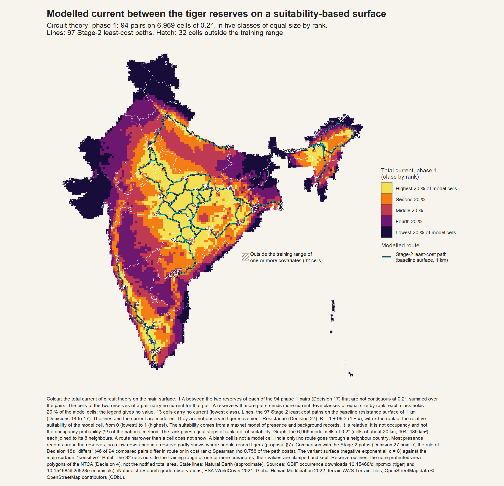
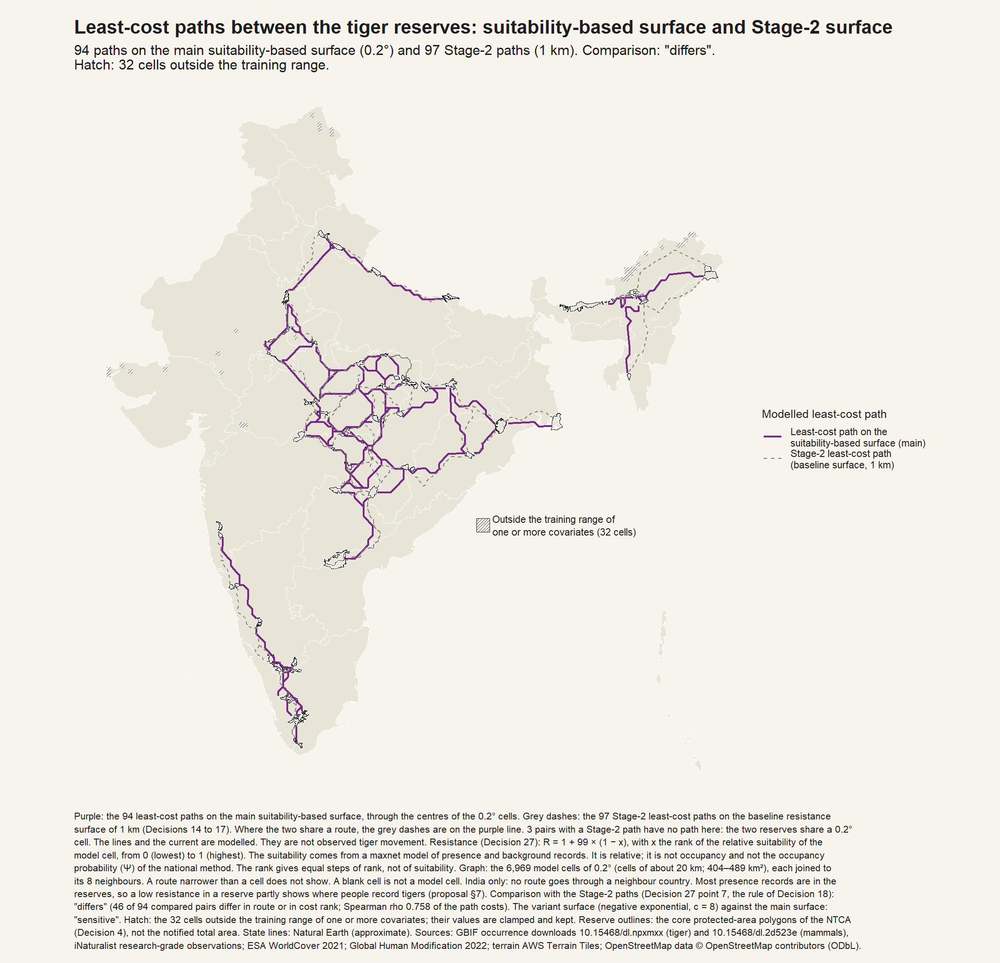

<!-- Skeleton of Week 18 (Decision 28 a3, p1 of task 18.4). The title, the
headings, the labels and the alt texts are drafts of the chat; the narrative
is the author's (Week 20). Each figure is its PNG file as a static stand-in
(S1); an interactive map follows in Week 19 only where the rule of
"Published layers" allows its layer (R7). The tables come from
scripts/11_build_site.R: do not edit the files in tables/ by hand. -->

::: {.callout-note appearance="simple"}
**Placeholder** — the author's text (Week 20).
:::

## `fig_07_sdm_current`

<!-- DRAFT (chat; Decision 28 f2): the alt text. The author's edit is in Week 20. -->
{fig-alt="A map of India in cells of 0.2 degrees (about 20 km). Each model cell has one of five colours, from the lowest 20 percent to the highest 20 percent of the total modelled current of circuit theory between the pairs of tiger reserves, on a resistance surface from the habitat suitability. Cyan lines are the Stage-2 least-cost paths."}

## `fig_08_sdm_paths`

<!-- DRAFT (chat; Decision 28 f2): the alt text. The author's edit is in Week 20. -->
{fig-alt="A map of India with two sets of modelled least-cost paths between the tiger reserves: solid purple lines on the surface from the habitat suitability (cells of 0.2 degrees), and grey dashed lines on the Stage-2 surface (cells of 1 km)."}

## `tbl_19_sdmres_compare_summary`



## Long tables (links)


