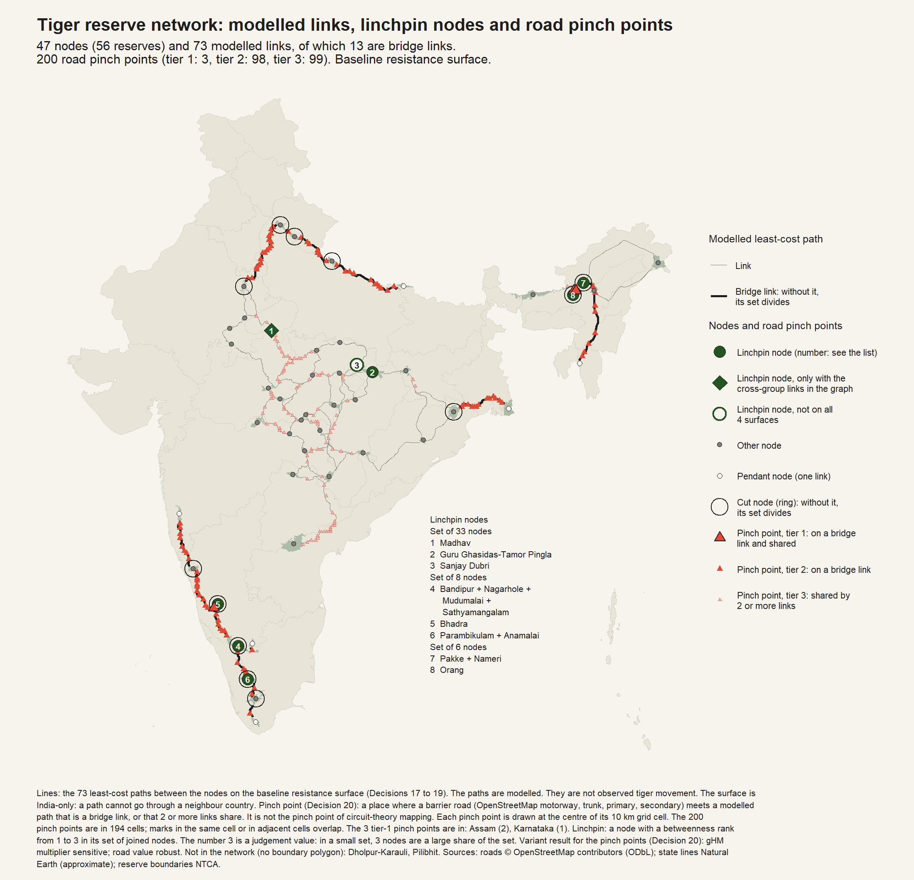

<!-- Skeleton of Week 18 (Decision 28). The headings, the labels and the alt
texts are drafts of the chat; the narrative is the author's (Week 20). The
figure is its PNG file as a static stand-in (S1); an interactive map follows
in Week 19 only where the rule of "Published layers" allows its layer (R7).
The tables come from scripts/11_build_site.R: do not edit the files in
tables/ by hand. -->

::: {.callout-note appearance="simple"}
**Placeholder** — the author's text (Week 20).
:::

## `fig_03_reserve_network`

<!-- DRAFT (chat; Decision 28 f2): the alt text. The author's edit is in Week 20. -->
{fig-alt="A map of India with the network of the tiger reserves. Marks at the reserves are the nodes of the network. Lines are the modelled least-cost paths between the nodes; the bridge links are thick and dark. Triangles are the road pinch points, each at the centre of a 10 km grid cell."}

## `tbl_03_reserve_network`



## `tbl_03_notes`



## Long tables (links)


