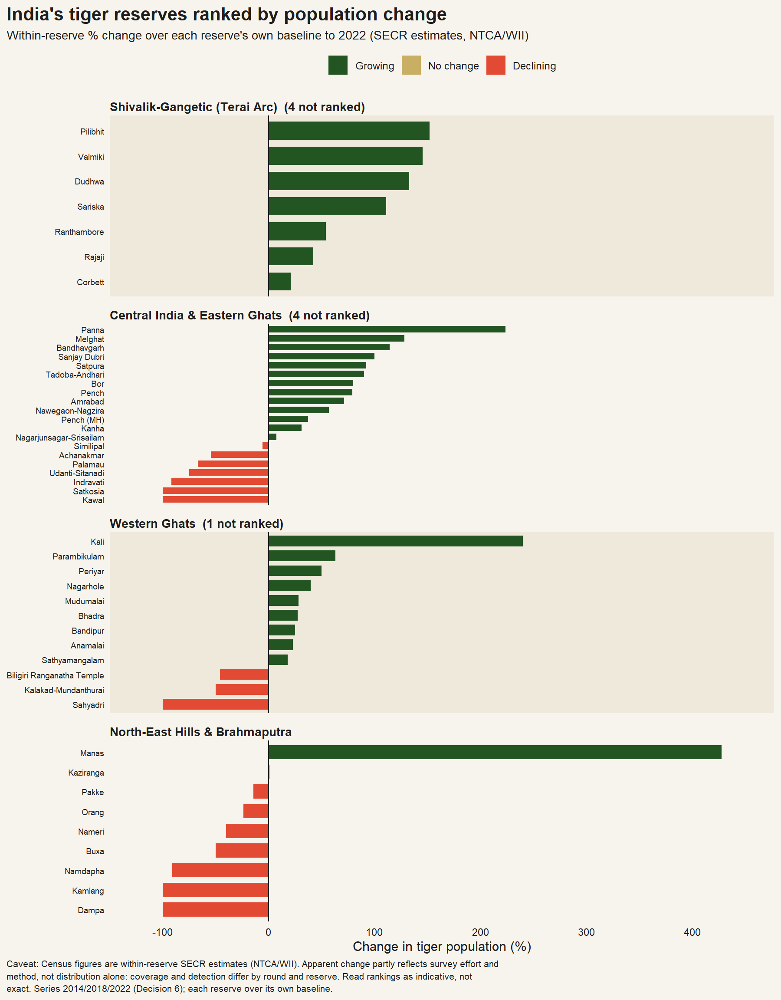
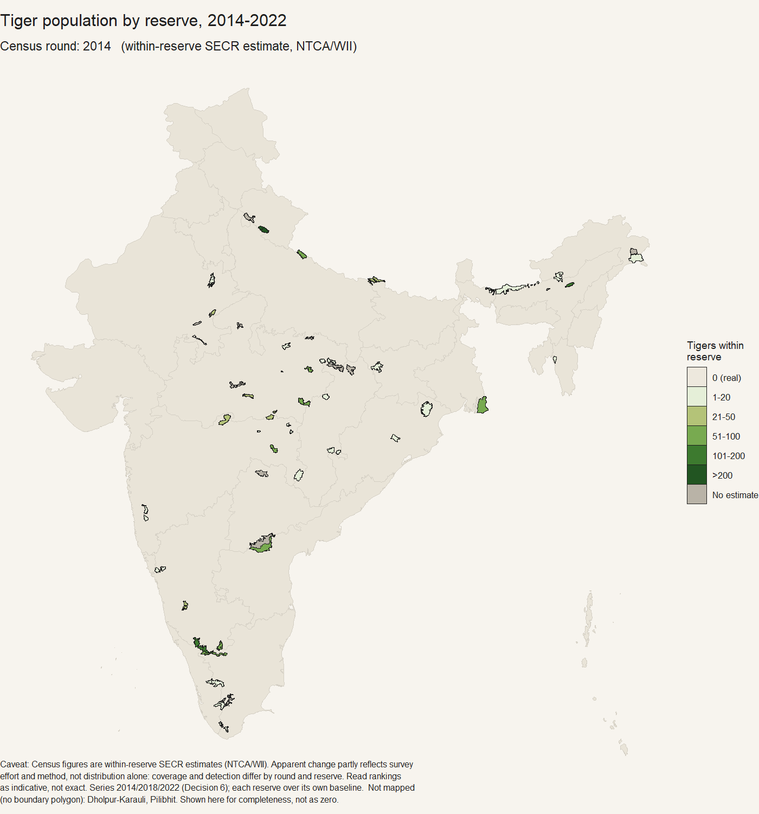

<!-- Skeleton of Week 18 (Decision 28). The headings, the labels and the alt
texts are drafts of the chat; the narrative is the author's (Week 20). Each
figure is its PNG file as a static stand-in (S1); the interactive chart and
map follow in Week 19 (R7). The tables come from scripts/11_build_site.R:
do not edit the files in tables/ by hand. -->

::: {.callout-note appearance="simple"}
**Placeholder** — the author's text (Week 20).
:::

## `fig_01_growth_ranking`

<!-- DRAFT (chat; Decision 28 f2): the alt text. The author's edit is in Week 20. -->
{fig-alt="A bar chart of the tiger reserves of India in panels by landscape complex. The length of each bar is the change in the within-reserve tiger estimate, in percent, from the first census round of the reserve to 2022. The colour shows growth or decline."}

## `fig_02_growth_animation`

<!-- DRAFT (chat; Decision 28 f2): the alt text. The author's edit is in Week 20. -->
{fig-alt="An animated map of India in three frames, one for each census round (2014, 2018 and 2022). The colour of each tiger reserve is its within-reserve tiger estimate in that round."}

## `tbl_01_reserve_growth`



## `tbl_02_regional_rollup`


