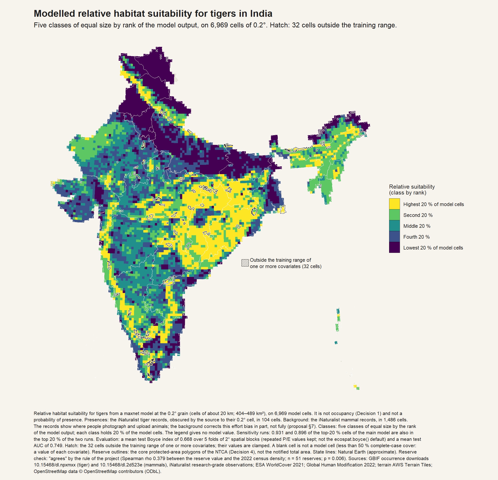
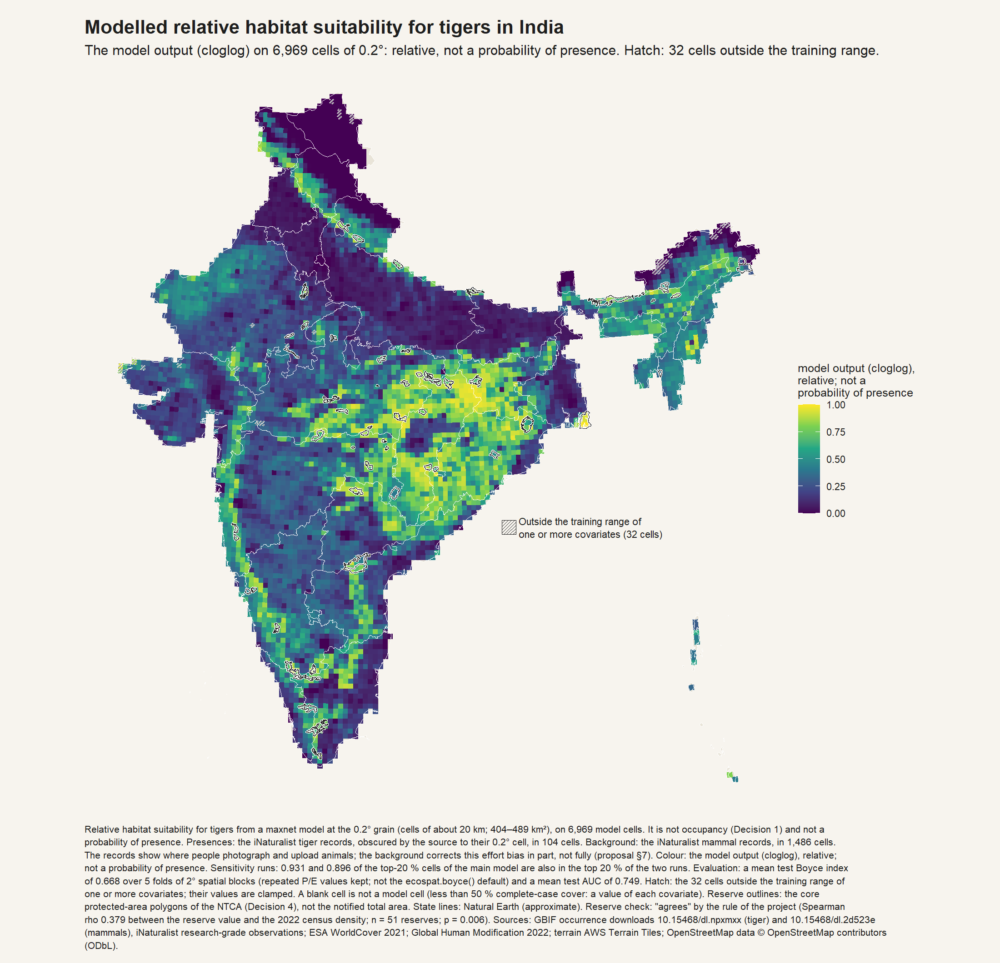
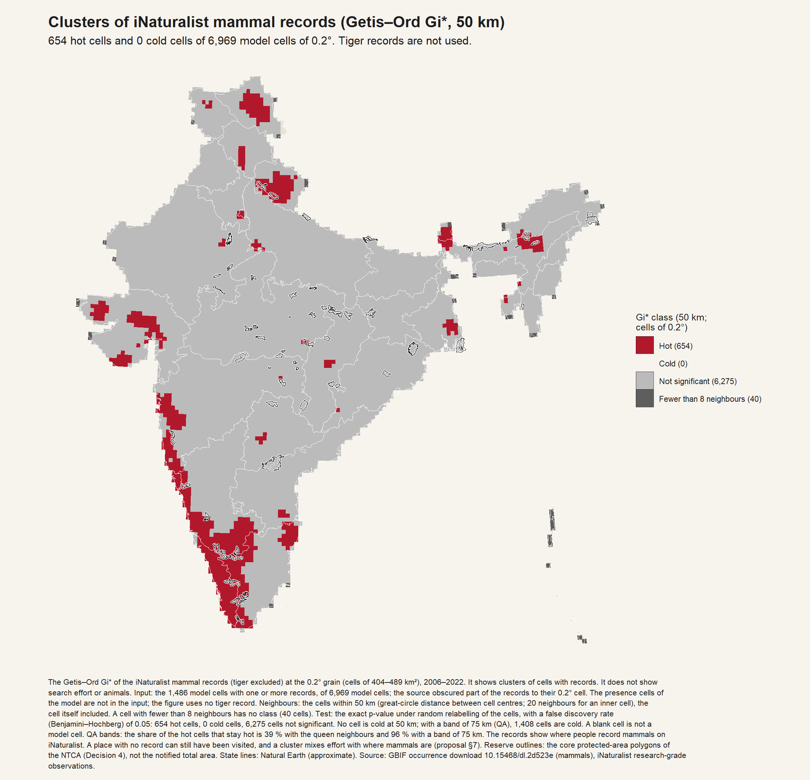

<!-- Skeleton of Week 18 (Decision 28). The headings, the labels and the alt
texts are drafts of the chat; the narrative is the author's (Week 20). Each
figure is its PNG file as a static stand-in (S1); an interactive map follows
in Week 19 only where the rule of "Published layers" allows its layer (R7).
The tables come from scripts/11_build_site.R: do not edit the files in
tables/ by hand. Do not add a total of a table with "<3" values (Decision 22
point 9). -->

::: {.callout-note appearance="simple"}
**Placeholder** — the author's text (Week 20).
:::

## `fig_04_suitability_classes`

<!-- DRAFT (chat; Decision 28 f2): the alt text. The author's edit is in Week 20. -->
{fig-alt="A map of India in cells of 0.2 degrees (about 20 km). Each model cell has one of five colours, from the lowest 20 percent to the highest 20 percent of the modelled relative habitat suitability by rank. The suitability is relative; it is not a probability of presence. Lines are the reserve outlines; hatched cells are outside the training range of the model."}

## `fig_05_suitability_value`

<!-- DRAFT (chat; Decision 28 f2): the alt text. The author's edit is in Week 20. -->
{fig-alt="A map of India in cells of 0.2 degrees (about 20 km). The colour of each model cell is the model output (cloglog) on a continuous scale. The value is relative; it is not a probability of presence. Lines are the reserve outlines; hatched cells are outside the training range of the model."}

## `tbl_17_reserve_suitability`



## Effort

::: {.callout-note appearance="simple"}
**Placeholder** — the author's text (Week 20).
:::

### `fig_06_effort_gistar`

<!-- DRAFT (chat; Decision 28 f2): the alt text. The author's edit is in Week 20. -->
{fig-alt="A map of India in cells of 0.2 degrees (about 20 km). The colour of each model cell is its class in the Getis-Ord Gi* statistic of the iNaturalist records of mammals other than the tiger, with a band of 50 km: hot, cold, not significant, or too few neighbours. The map holds no tiger record."}

### `tbl_15_occ_by_reserve`



### Long tables (links)


